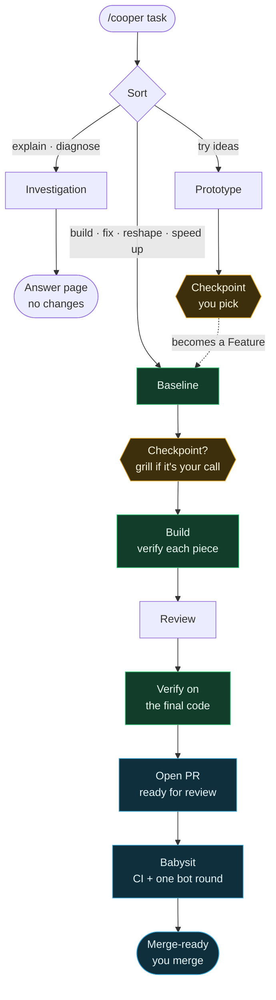
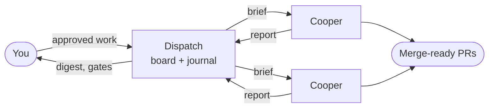

# Dan's loadout

The skills, agents, programs, and MCP servers Dan's machines run, applied by the [loadout](https://github.com/dan-myles/loadout) CLI from `main`. Most of it is **Cooper**, an engineer you hand a task to, and **Dispatch**, the project lead that runs Coopers for a repo. Both run in [T3 Code](https://github.com/pingdotgg/t3code).

Setting up a machine and where each agent gets its skills: [docs/operations.md](docs/operations.md).

## Cooper

Give Cooper a task. Get back a merge-ready PR, verified, with CI green and every review bot answered once. Cooper stops for you only at a **Checkpoint**, and merging is always yours.



### The playbooks

| Playbook | Use it when | Baseline | Final check | Ends at |
|---|---|---|---|---|
| **Feature** | New or different behavior | Learn the area, draft the design | The real surface, as a Proof gallery | Merge-ready PR |
| **Bug** | Something is wrong | Watch it fail, narrow the cause | Rerun the reproduction | Merge-ready PR |
| **Refactor** | Better structure, same behavior | Pin today's behavior | Pin, every entry point, old vs new | Merge-ready PR |
| **Perf** | Too slow or too heavy | Measure it | Same harness, baseline vs final | Merge-ready PR |
| **Investigation** | You want an answer, not a change | Read the code and its history | Run what each claim rests on | An answer page |
| **Prototype** | You want to see options first | Name the decision | Look at each variant as you would | Your pick |
| **Orchestrate** | Work too big for one thread | Countable done condition | A verifier per PR, other model family | Merge-ready PRs |

Click a playbook for its steps.

<details>
<summary><b>Feature</b>: build something new</summary>

1. **Learn the ground** with `cooper-how` (and `cooper-why` on code that looks deliberate). File map of the area.
2. **Checkpoint**, only if the feature touches one of your calls: grill it.
3. **Draft the design**: data shape, where it lives, signatures, callers. `cooper-architect` for a new service, module, or interface. A call of yours that turns up here grills too.
4. **Plan** as four items: what goes first, what runs in parallel, what's contended, how many workers.
5. **Build, verifying each piece.** Subagents build from briefs that name the check; each runs it, Cooper reruns it, then commits.
6. **Review.**
7. **Verify it all on the final code** where you'd use it, through the repo's verify skill. Shown as a Proof gallery.
8. **Ship:** Open PR, then Babysit.

</details>

<details>
<summary><b>Bug</b>: make wrong behavior right</summary>

1. **Reproduce:** watch it fail on the surface where it was reported, and save the output.
2. **Evidence:** narrow the cause with real output each round, ruled-out suspects struck through.
3. **Plan** the smallest fix. **Checkpoint** if it touches one of your calls. When only the right behavior is unclear, Cooper picks what the code, tests, and docs point to and names it in the PR.
4. **Write the regression test** and watch it fail. Commit it.
5. **Build the fix** with a subagent; the test turns green, Cooper reruns it, commits on top.
6. **Review.**
7. **Final verification:** rerun the step 1 reproduction on the same surface, before next to after.
8. **Ship:** Open PR, then Babysit.

</details>

<details>
<summary><b>Refactor</b>: same behavior, better structure</summary>

1. **Pin the behavior:** a characterization test, snapshot, or old-vs-new diff, committed alone.
2. **Name what's missing:** the state machine, typed model, or table the branches stand in for.
3. **Name the target shape.** **Checkpoint** if it touches one of your calls, including breaking a public interface.
4. **Delete first,** rerun the pin, commit.
5. **Reshape in small steps.** The pin runs after every step, by the subagent and again by Cooper.
6. **Worth keeping?** Fewer layers or less state, or it's reverted.
7. **Review.**
8. **Verify nothing changed** on the final code: pin, repo checks, every entry point, old vs new.
9. **Ship:** commits ordered pin, deletions, reshape, cleanup. Open PR, then Babysit.

</details>

<details>
<summary><b>Perf</b>: make it faster or lighter</summary>

**Fix** mode, for one slow thing:

1. **Reproduce and measure** on your surface; vet the baseline.
2. **Ground the guesses** in the profile. Cheapest fix first: don't do it, do it once, do less, do it later, do it off the critical path, do it concurrently, do it cheaper.
3. **Plan** from the profile. **Checkpoint** if it touches one of your calls.
4. **Build in attempts,** each measured. Keep what moves the number, revert what doesn't.
5. **Review.**
6. **Verify on the final code:** same harness, baseline vs final, behavior unchanged.
7. **Ship.**

**Climb** mode, for pushing a metric to a target: pick the case, metric, and stop rule (yours, or Cooper's shown and kept), freeze a harness, then loop one change at a time, measured, kept or reverted, logged in `decision.tsv`. Review, final measurement, ship.

</details>

<details>
<summary><b>Investigation</b>: an answer, no changes</summary>

**Explain:** `cooper-how` on the area, `cooper-why` for "why", lay out the answer, **run something for each claim it rests on**, publish the page. A claim that couldn't be run is marked as read from code.

**Diagnose** a leak, spin, hang, or glitch: get the capture, make it queryable, narrow to the cause, **prove the mechanism**, map it to source, publish the page.

</details>

<details>
<summary><b>Prototype</b>: see options before building</summary>

Name the decision, gather references, build throwaway variants in `/tmp` behind one switcher, look at each as you would, then the **Checkpoint**: you pick. The pick becomes a Feature.

</details>

<details>
<summary><b>Open PR</b> and <b>Babysit</b>: the shared ending</summary>

**Open PR** runs on its own at the end of Feature, Bug, Refactor, and Perf, or when you say "open the PR": repo checks until clean, commits in story order (stacked when the diff has several kinds of change), opened **ready for review**, never a draft, with a body a reviewer reads in a minute. The final check's proof is posted in it: command output as text, plus screenshots and recordings for frontend changes, uploaded to GitHub with `gh --attach`.

**Babysit** runs after it, or when you say "check on #123": conflicts, then review threads, then CI.

- One review round: each bot's first review is answered. Cooper doesn't wait for re-reviews.
- Bot threads get a fix or a dismissal and are resolved, without a reply. Humans get replies.
- A fix reruns the playbook's final check before it's pushed, and that proof is posted as a PR comment.
- Waits with T3's PR watch, not polling. Stops at merge-ready. Never merges.

</details>

<details>
<summary><b>Orchestrate</b>: a whole program</summary>

The Cooper thread coordinates and never writes code. It frames a countable done condition, takes one unit all the way through first, then runs up to four Cooper workers in their own worktrees. Each kickoff names the evidence that proves the unit done and tells the worker where to report. A verifier on the other model family checks each PR at its current head. No store: the picture is whatever T3 and GitHub show right now, the way pstack's Orchestrate works.

</details>

### Checkpoints

A Checkpoint is any stop for you. There are three kinds, and nothing else stops:

- **Grill** (`cooper-grill`): a call that's yours and the request leaves open. Schema and stored data, infrastructure, how services talk, providers, money values, shared contracts, one-way doors, and a feature's product or taste calls. Size doesn't matter. Cooper decides everything else and names it in the PR.
- **Prototype's pick** between variants.
- **Babysit's question** about a new, high-stakes review comment.

Answer **Send it** to take Cooper's pick. When Dispatch runs Cooper headless, its brief tells Cooper to skip Checkpoints and report a gate instead.

### Review

Every diff gets a **decision check** against what you've already decided. `cooper-no-comments` strips the comments a diff adds and fixes the code they were excusing. `cooper-blast-radius` proves what the change can't break outside its diff, by running code. No agent reads the diff for opinions; the final verification runs it instead.

### What it feels like

```
you:     /cooper add a weekly leaderboard to the tournaments page

cooper:  [plan: Feature → learn → design → build → review → verify → ship]
         [file map of every new and changed file]
         [GPT subagents build it piece by piece, each piece checked]
         [checked in the real app: before/after screenshots]
         PR #412 opened ready for review. CI green, Bugbot's review answered.
         Merge-ready, waiting on you.
```

## Dispatch

Dispatch is a long-running, pinned T3 thread that leads one repository. It breaks approved work into briefs, launches a Cooper for each in its own worktree, chases CI and stalls, and keeps a board in `.dispatch/<id>/` in the repo. It never writes repo code and never merges.



Cooper's skills know nothing about Dispatch. Everything a worker needs from Dispatch, including where to report back, travels in the brief Dispatch writes.

The store, takeover, and model declarations: [docs/dispatch.md](docs/dispatch.md).

## The cast

| Skill | What it's for |
|---|---|
| `/cooper <task>` | The front door: sorts the task into a playbook and runs it. |
| `/cooper-grill` | Settles your open calls, round by round, each with a recommended answer. |
| `/cooper-how`, `/cooper-why` | How code works, and why it ended up that way, as interactive pages. |
| `/cooper-architect` | Two designers on two model families, a judge, one merged design. |
| `/cooper-blast-radius` | What a change breaks outside its diff, proven by running code. |
| `/cooper-no-comments` | Comment Sicko strips the diff's comments; the code they excused gets fixed. |
| `/cooper-verify` | Writes a repo's own `cooper-verify-<app>` skill so Cooper can drive the real app. |
| `/cooper-sharpen <prompt>` | Rewrites a prompt to ask for a deeper task, not a bigger one. |
| `/cooper-models` | Reviews and upgrades the model declared at each launch step. |
| `/cooper-improve` | Cooper learns from a session that went sideways and fixes his own skills. |
| `cooper-principle-*` | 24 short engineering principles Cooper reads when a step needs one. |
| `dispatch`, `dispatch-*` | The project lead and its setup, decompose, chase, and digest modes. |

## House rules

- Cooper never merges, deploys, deletes data, or force-pushes shared branches without you.
- Everything Cooper says is backed by a run, a line of code, or flagged as a guess.
- Comments explain why. Prototypes never ship.
- If a session went sideways, run `/cooper-improve`.

## Credits

- **[pstack](https://github.com/cursor/plugins/tree/main/pstack)** by Lauren Tan: the playbooks, the principles, and the engineering bar (one job, verified, no slop).
- **[Matt Pocock's skills](https://github.com/mattpocock/skills)**: grilling, and Wayfinder's durable maps for planning across sessions.
- **[Engineering Lead](https://x.ai/bot/marketplace/bots/engineering-lead)** by Lauren Tan: onboard, decompose, run, chase, and report; keep healthy work quiet.

## For agents working on this repo

Read [`PARKING_LOT.md`](./PARKING_LOT.md) first: the ground rules, how to add a skill, every decision so far, and where the work stopped. Machine setup is in [docs/operations.md](docs/operations.md).
